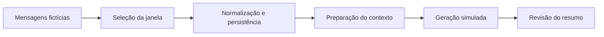

# Arquitetura de referência

Fluxo abstrato para discussão; não representa um serviço disponível.

## Decisões a avaliar

Coleta e consolidação têm ritmos e falhas distintos. Registrar a posição de processamento ajuda na retomada, mas exige uma decisão explícita sobre mensagens que chegam atrasadas e sobre quando considerar uma janela concluída.

A saída de um modelo não deve adquirir autoridade sobre a conversa. Um resumo pode omitir ressalvas ou atribuir uma decisão que não ocorreu. Separar tópicos, decisões confirmadas e pendências facilita revisão, sem dispensar controle de acesso ao conteúdo original.

## Roteiro de validação

- Processar uma janela vazia.
- Repetir a mesma janela e conferir a política de duplicação.
- Inserir uma mensagem atrasada e verificar o tratamento previsto.
- Interromper a geração e conferir a retomada sem perda de mensagens.
- Usar diálogo sintético com discordância e verificar que não surge uma decisão falsa.
- Testar retenção e exclusão do conteúdo intermediário.

Os itens são propostas de avaliação, não testes executados. Este repositório não contém modelo, prompt operacional nem dados de conversas.
